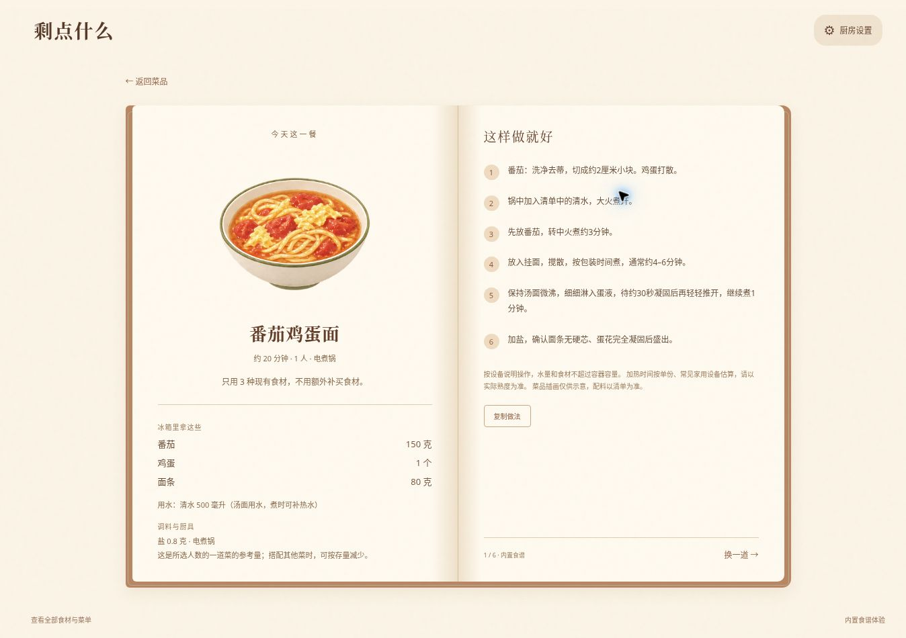

# 剩点什么

打开冰箱，选出剩下的食材，找到现在能做的一道家常菜。

一个使用 AI 辅助设计与开发的做饭推荐 Demo：用暖色纸张拼贴冰箱选择食材，再从成品菜卡片进入绘本食谱。**默认推荐由浏览器内的菜谱库和规则完成**，不需要 API 密钥，不消耗模型 token。另有可选的 DeepSeek 入口：预览并确认本次做饭数据后才调用服务端接口；默认使用内置菜单。



## 为什么做

下班后面对半个番茄、两个鸡蛋，不想先想菜名、再逐条核对缺什么。这里先选自己有什么，再看能做什么。每道菜只取必要的食材，其他食材可以留着。

## 可以体验什么

- 54 种常用食材、6 页冰箱，跨页选择保留；支持“西红柿”“剩饭”等常见别名。
- 110 道具名菜谱及对应成品插画；炒锅、电煮锅、电饭煲、微波炉、空气炸锅、免开火均有做法。
- 根据食材、实际厨具、调料、时间、简单忌口筛选；可优先消耗某一种食材。
- 最多展示 12 道推荐；先选菜，再打开食谱；可返回重新选择。
- 食材与调料用量按 1–3 人换算，显示用水、切配、火力/功率、参考时长及完成判断。
- 分批制作会增加预计时间；多份不会简单把微波、烘烤温度提高。
- 复制做法包含所选人数的用量；完整清单可在页面查看。

## 60 秒上手

需要 Node.js 22.13 或更高版本。默认体验**无需安装依赖**：

```bash
node server.mjs
```

打开终端显示的 `http://localhost:3000`。按 `Ctrl+C` 停止。

1. 在冰箱选择鸡蛋、番茄和面条。
2. 在“厨具与调料”设置人数、厨具和时间。
3. 点击“确认食材，查看食谱”。
4. 比较番茄炒蛋、番茄鸡蛋面等卡片，打开其中一道查看做法。

也可用任意静态服务器托管 `public/`。浏览器用到的资源都在本项目内，不依赖外部图片服务。

## 验证与更新菜单

```bash
npm test
npm run check
npm run catalog:export
```

测试覆盖食材子集匹配、厨具/调料/忌口/时间约束、110 道菜单可达性、每道菜的插画、人数用量换算、分批用时及复制文本一致性。自动化测试通过不等于菜谱已经逐道实地试做。

编辑 `public/catalog.js` 后运行 `catalog:export`，同步生成可阅读的 `public/menu-list.md` 和可复用的 `public/recipe-catalog.json`。

## 项目结构

| 文件 | 用途 |
| --- | --- |
| `public/index.html`、`app.js`、`style.css` | 冰箱、推荐卡片、绘本食谱与响应式交互 |
| `public/catalog.js` | 54 种食材、110 道菜、参考用量与步骤 |
| `public/recipes.js` | 别名识别、约束筛选与多样性排序 |
| `public/cooking-guide.js` | 人数换算、分批时间与复制文本 |
| `public/dish-illustrations.js`、`assets/` | 成品菜与食材图集、拼贴厨房背景 |
| `server.mjs` | 无依赖本地预览与保留的可选 API |
| `worker-api.mjs`、`recipe-privacy.mjs` | 可选服务端接口与输入过滤 |
| `tests/` | Node.js 内置测试，无需测试框架 |
| `docs/product.md` | 产品决策、项目展示与后续验证计划 |
| `docs/recipe-notes.md` | 参考用量、烹饪信息与来源说明 |

此源码包包含可独立运行的浏览器应用和 Node 预览服务；平台托管专用的构建文件未打包。运行 npm start 或 node server.mjs 即可体验。

## 推荐如何工作

先把常见别名归一化，再筛出所有必需食材、调料和厨具都具备的菜。用所选人数估计分批时间，排除超时及明确不吃的食材。排序考虑“优先用掉”、做法与厨具多样性，避免结果被同类菜占满。

例如选择“鸡蛋、番茄、面条”，番茄炒蛋只使用鸡蛋和番茄；不会强行把面条放进去。没有选油时，不会推荐必须用油的炒菜，可以保留适用的煮面或汤。

## 当前边界

- 自由输入用于识别已收录食材，不会生成任意新菜；输入的数量暂不用于库存核算。
- 人数用量是**一道菜的参考量**，不是保证库存够用的承诺，也不是整餐营养方案。
- 实际用时受锅具容量、食材厚度、功率影响；大份量需分批，电饭煲以实际程序为准。
- 复杂过敏、交叉接触、包装配料不能由本地菜单可靠核实，页面会提示核对；不能宣称过敏安全。
- 菜谱未经全部实地烹饪验证，插画也不用于判断食材熟度。

## 隐私与可选 API

默认内置模式在浏览器内存中完成选择和推荐，不发给模型。可选DeepSeek模式只发送预览中已确认的做饭数据，无聊天历史、个人记忆、账号资料读取逻辑，不保存请求正文或选择到服务端。第三方会收到确认的数据，其留存政策不能由本项目保证。

`/api/status` 与 `/api/recipes` 接口按项目要求保留。未配置服务端密钥时返回未启用状态；DeepSeek入口只在用户预览并确认后请求生成；未配置密钥时不会调用。已设置单次输出限制、超时、基础实例限流及错误处理，面向公众开放前仍需补全可靠鉴权、持久化配额和预算控制。不要把密钥放入前端、源码或 GitHub。

完整接入步骤、需要的服务端变量和隐私边界见 [DeepSeek接入说明](docs/deepseek.md)。本次只有模拟测试，尚未使用真实密钥联调。


